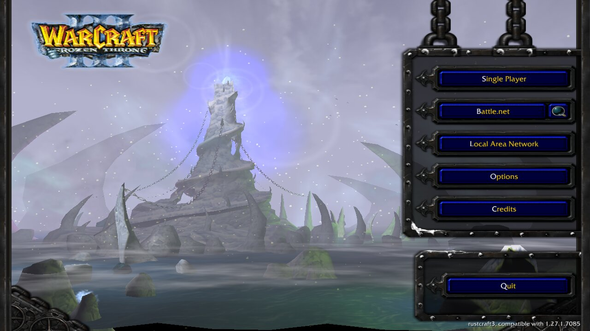
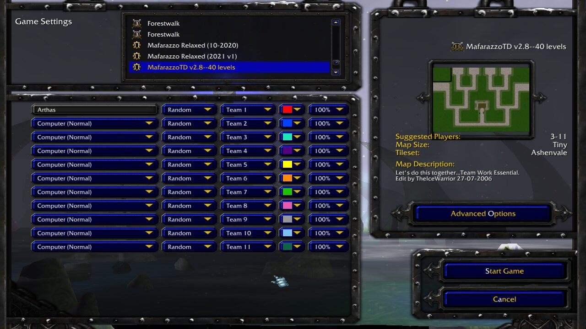
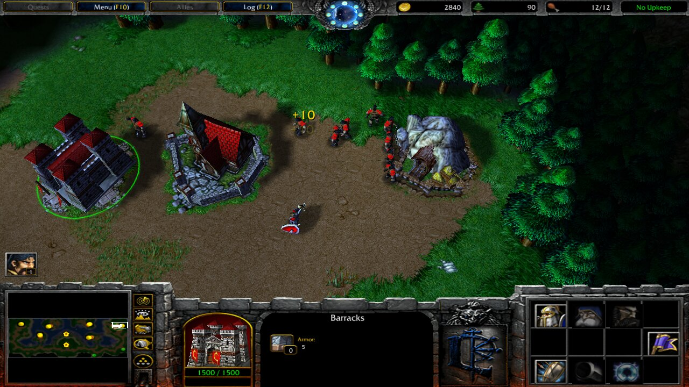
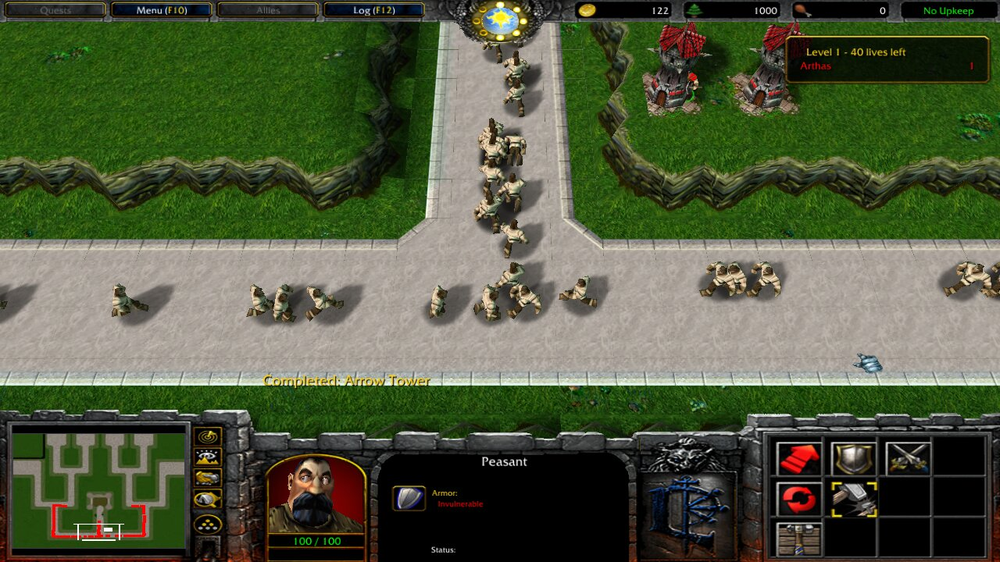

# rustcraft3

rustcraft3 is a port of Warcraft III: Reign of Chaos and The Frozen Throne to Rust,
compatible with the original game's version 1.27b (1.27.1.7085).  It runs on the original's
data files, which are not part of this project: you need your own copy of the game.

<p>




</p>

## Setting it up

### 1. The program

**Download it.**  Each [release](https://github.com/jackrosenthal/rustcraft3/releases)
has an archive for each platform, holding the program, `war3` (`war3.exe` on Windows):

| Platform | Archive |
|---|---|
| Linux (x86-64) | `rustcraft3-<version>-linux-x86_64.tar.gz` |
| Windows (x86-64) | `rustcraft3-<version>-windows-x86_64.zip` |
| macOS (Apple silicon) | `rustcraft3-<version>-macos-aarch64.tar.gz` |

Every commit's builds are also kept, under the same names with the commit's hash for the
version, as the artifacts of its run on the
[Actions](https://github.com/jackrosenthal/rustcraft3/actions) page.  On Linux the program
needs ALSA (`libasound.so.2`) and a Vulkan driver.  The macOS build is not signed; if macOS
refuses to open it, clear its quarantine with `xattr -d com.apple.quarantine war3`.

**Or build it.**  With Rust 1.90 or newer:

```sh
cargo build --release
```

The program is then `target/release/war3`.  On Linux the build also needs pkg-config and
ALSA's headers: `libasound2-dev` on Debian and Ubuntu, `alsa-lib-devel` on Fedora, and
`alsa-lib` on Arch.

### 2. The game's files

rustcraft3 reads these from the game's folder:

| File | What it holds | Needed |
|---|---|---|
| `War3.mpq` | Reign of Chaos | Always |
| `War3x.mpq`, `War3xLocal.mpq` | The Frozen Throne | For The Frozen Throne: without `War3x.mpq` the game is Reign of Chaos |
| `War3Patch.mpq` | Patch 1.27b | Always: rustcraft3 follows 1.27b's data |
| `Maps` | The maps the custom game and LAN screens list | For custom and LAN games |
| `Campaigns` | Custom campaigns | For custom campaigns |

The archives' names may be in any case (`war3.mpq` will do); the two folders must be named
`Maps` and `Campaigns`.  These files are Blizzard's; don't redistribute them.

They come from an installed game, or from the CDs and Blizzard's 1.27b patch.

**An installed game.**  A Warcraft III installed on Windows, or under Wine, and patched to
1.27b has all of them in its folder, the one holding `War3.mpq`.  Point rustcraft3 at that
folder, or copy the files above into a folder of their own.  rustcraft3 leaves the folder
as it is but for one thing: a map it downloads to join a LAN game goes into
`Maps\Download`.

**The CDs.**  The archives come out of the games' installers, so install the games from
their CDs (on Linux or macOS, under Wine), patch them to 1.27b, and use the installed
folder.  The 2002 Reign of Chaos CD holds `install.exe`, `Setup.mpq`, and version 1.00's
`War3.mpq`; the 2003 Frozen Throne CD holds only `install.exe` and `Setup.mpq`, the
installer's archive, and no `War3x.mpq`.  Later printings of both hold `Installer.exe` and
`Installer Tome.mpq` instead.

**The 1.27b patch.**  The patch makes `War3Patch.mpq` in the game's folder, and
Blizzard's server still has it:

- For The Frozen Throne (both games installed):
  <http://ftp.blizzard.com/pub/war3x/patches/pc/War3TFT_127b_English.exe>
- For Reign of Chaos alone:
  <http://ftp.blizzard.com/pub/war3/patches/pc/War3ROC_127b_English.exe>

Run it on Windows, or under Wine in the prefix the game was installed in: it finds the game
through the registry, and fails without the game's entry there.

### 3. Starting it

```sh
war3 --datadir "/path/to/Warcraft III"
```

Without `--datadir`, rustcraft3 looks for `War3.mpq` in the current folder, in the
program's folder, and in a folder named `Warcraft III` in either.  On Windows, keep
`war3.exe` out of the original's folder, which has a `war3.exe` of its own.

The game starts fullscreen; `--window` plays it in a window (`--width` and `--height` set its
size), and `--classic` plays Reign of Chaos with The Frozen Throne installed.  The
original's switches work as it spelled them, too (`-window`, `-classic`, `-datadir`), and
`war3 --help` lists the rest.
